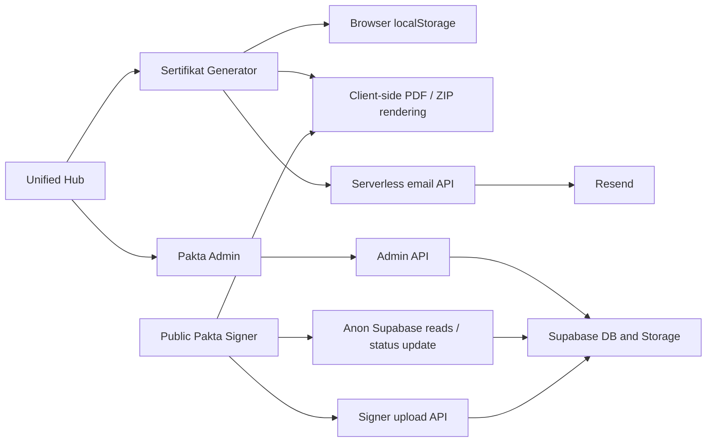
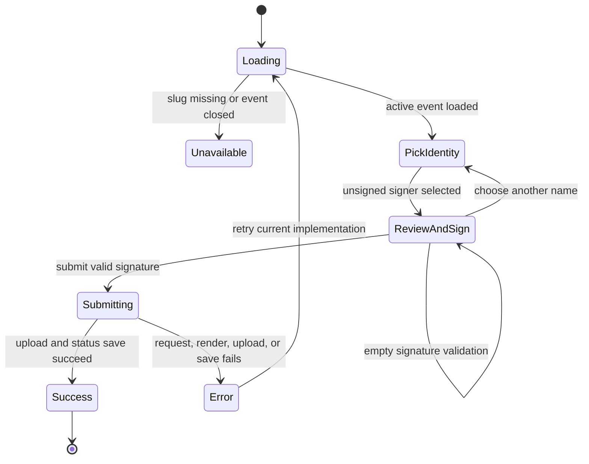

# Product Requirements Document — Sertifikat Generator UI/UX Redesign

**Date:** 17 August 2026

**Status:** Ready for redesign handoff

**Product:** Sertifikat Generator — Balai P3KP Jawa III

**Source snapshot reviewed:** GitHub `main` at `65e6927`

**Primary audience:** Product designer, UI/UX designer, frontend engineer, QA engineer, and autonomous implementation agent
**Language requirement:** Formal Bahasa Indonesia for all user-facing copy

## Problem Statement

Sertifikat Generator already supports two valuable but operationally different products:

1. **Sertifikat Generator**, where an internal operator creates certificate activities, lays out fields over an uploaded background, issues certificates individually or in bulk, downloads PDFs/ZIP files, and can email generated PDFs.
2. **Pakta Integritas**, where an admin creates a document event in Supabase, configures a template, imports employees, shares one public link or QR code, monitors signatures, and archives signed PDFs while employees sign from their own devices.

The current application exposes most of the required business capability, but the experience feels like a collection of screens rather than one dependable operational workspace. Navigation, lifecycle terminology, information hierarchy, readiness, progress, recovery, responsive patterns, and action priority differ across modules. Operators must understand implementation details—local browser storage, counters, fields, slugs, signed URLs, and manual refreshes—to know what is safe to do next.

The result is avoidable operational risk:

- A certificate activity can appear ready even when its template is incomplete.
- Certificate numbering can be reset into an already-issued range, and a failed bulk run can consume numbers without producing a complete deliverable.
- A Pakta event is public as soon as it is created, even when it has no participants or signature field.
- The public Pakta fallback allows a user to draw a signature when no signature field exists, but the final PDF omits that signature.
- Long-running generation, upload, email, download, and signing operations do not always provide accurate status, recovery, or a durable result summary.
- Certificate data is local to one browser, while Pakta data is remote; the shared shell does not explain this distinction clearly.
- Mobile layouts technically expose many features, but data density, signature size, editor controls, and action placement can make important work difficult.
- Existing styles mix legacy `apple-*`, newer `sg-*`, and inline rules, so future redesign work could create a third inconsistent visual language.

The redesign must therefore do more than restyle pages. It must make the current business processes legible, guide users through safe next actions, preserve proven document-generation behavior, expose important system constraints, and give another agent enough precision to implement the experience without inventing business rules.

## Solution

Redesign the application as a **modern institutional operations workspace** with one coherent admin experience and one focused public signing experience. The redesign will preserve the existing domain architecture while improving information architecture, lifecycle clarity, workflow guidance, responsive behavior, accessibility, error recovery, and visual consistency.

### Product principles

- **Operational clarity over decoration.** Every page must answer: where am I, what is the current state, what needs attention, and what is the next safe action?
- **One primary action per state.** Secondary and destructive actions remain available but are visually separated.
- **Business state is explicit.** Do not rely on color alone or force users to infer readiness from counters or empty tables.
- **Preview before irreversible work.** Generation, sending, publishing, reset, counter changes, and deletion require an understandable preview or confirmation proportional to their risk.
- **Progress must be truthful.** Labels, counts, phases, and completion summaries must match actual work.
- **Recover without starting over.** Preserve user input and valid intermediate results whenever retry is safe.
- **Desktop and mobile have feature parity.** Layouts may differ, but required information and actions may not disappear.
- **Formal, calm, institutional tone.** Use concise Bahasa Indonesia action labels and messages; avoid playful consumer language, decorative dashboards, and generic SaaS styling.
- **Accessibility is part of completion.** Keyboard use, touch use, focus, contrast, reduced motion, screen-reader naming, and zoom are acceptance requirements.

### Goals

- Unify navigation and page hierarchy across Sertifikat and Pakta Integritas.
- Reduce uncertainty about template readiness and next actions.
- Make certificate single, bulk, ZIP, and email flows easier to validate and recover.
- Make Pakta preparation, publication, monitoring, signing, and archiving safer and more understandable.
- Preserve document geometry, numbering rules, PDF output, import contracts, security boundaries, and storage behavior unless this PRD explicitly changes the user-visible rule.
- Provide a complete, handoff-ready specification for implementation by another agent.

### Success criteria

- A new operator can identify both modules and complete each priority journey without implementation knowledge.
- Every event or activity communicates its lifecycle, readiness, progress, and recommended next action.
- All priority journeys work at 375 px, 768 px, 1024 px, and 1440 px widths without horizontal page overflow or missing actions.
- All primary interactive targets are at least 44 × 44 px where touch interaction is expected.
- Keyboard order, visible focus, accessible names, modal focus handling, WCAG AA contrast, and reduced-motion behavior pass acceptance review.
- Existing business-logic tests for PDF rendering, field geometry, fonts, numbering, imports, storage, email, slugs, APIs, and Pakta signing continue to pass.
- The redesigned UI introduces route-level acceptance coverage for the complete certificate, Pakta-admin, and public-signer journeys.
- No redesign change exposes secrets, weakens the current server/admin boundary, or silently changes production Supabase configuration.

### Actors and responsibilities

| Actor | Responsibilities | System access |
|---|---|---|
| Certificate operator | Create activities, configure templates, issue single/bulk certificates, manage sequence numbers, download ZIPs, send email | No login; browser-local certificate data |
| Pakta admin/operator | Log in with shared password, create/configure events, import employees, open/close distribution, monitor, export, download, reset, delete | Admin API backed by Supabase service role |
| Pakta signer/employee | Open a public event link, find and confirm identity, review document, draw signature, submit, download own PDF immediately | Anonymous public flow; no OTP/account |
| Certificate recipient | Receives a downloaded or emailed certificate PDF | No application portal |
| Resend | Delivers certificate email and attachment | Called only through serverless email API |
| Supabase | Stores Pakta events, signers, templates, and final PDFs | Public anon access constrained by RLS; privileged admin access server-side only |

### Product architecture that the redesign must respect

- The app remains a React/TypeScript/Vite SPA with hash-based routing for this redesign.
- Certificate activities, backgrounds, template fields, counters, and email templates remain local to the current browser.
- Pakta data remains Supabase-backed and cross-device.
- PDFs remain client-rendered so preview and final document share the same field model.
- The public Pakta signer page remains outside the admin shell.

### Proposed information architecture

1. **Beranda**
   - Two clearly equal module entry points.
   - Short storage/context cues: Sertifikat is local to this browser; Pakta is server-backed and requires admin access.
   - No invented global analytics that cannot be reliably sourced.
2. **Sertifikat**
   - Activity list with search, status/readiness, issued count, storage cue, and one recommended next action.
   - Activity workspace containing Overview, Template, Generate, and Delivery context. These may be pages or clear sub-navigation, but must not exceed two visible hierarchy levels.
3. **Pakta Integritas — Admin**
   - Login boundary.
   - Event list with readiness, lifecycle, participant/signature progress, and recommended next action.
   - Event workspace containing Setup, Template, Participants, Distribution, and Results/Monitoring context.
4. **Pakta Integritas — Public Signer**
   - Focused step flow: identify → confirm → review and sign → submit → success/download.
   - No admin navigation or unrelated product controls.

### Current business workflow: app entry and navigation

1. Root opens the Hub.
2. User selects Sertifikat Generator or Pakta Integritas.
3. Admin views use a shared topbar and breadcrumbs; the public signer route bypasses the admin shell.
4. Logo and Beranda breadcrumb return to the Hub.
5. The redesign must preserve direct hash links and valid back/forward navigation.

### Current business workflow: Sertifikat Generator

#### A. Activity list and creation

1. Operator enters Sertifikat and sees activities stored in this browser.
2. Operator can search by activity name.
3. Each card exposes Edit Template, Generate/Print, and Delete.
4. Current card state is derived from numbering: `Draf` before a number has been claimed; otherwise it shows an issued count inferred from the number range.
5. To create an activity, the operator provides:
   - required activity name;
   - date, defaulting to today;
   - required PNG or JPG background.
6. Certificate backgrounds are limited to 5 MB and must decode as a valid image.
7. The system stores the natural image dimensions and creates defaults:
   - number pattern `{n}/SERT/{bulan}/{tahun}`;
   - starting number `1`;
   - padding `3`;
   - last issued `0`;
   - empty signatory name/title;
   - no template fields.
8. The activity is saved to localStorage and the editor opens immediately.
9. Deleting an activity permanently removes its template and counter from this browser.

#### B. Certificate template editor

1. The operator may add at most one of each supported certificate field:
   - Nama peserta;
   - Nomor sertifikat;
   - Peran/jabatan;
   - Nama acara;
   - Tanggal acara;
   - Nama penandatangan;
   - Jabatan penandatangan.
2. Fields are positioned in natural-image coordinates and rendered over the uploaded background.
3. Fields can be dragged and edited through X, Y, width, font size, font family, font weight, alignment, and color.
4. Nama peserta can be formatted as normal or uppercase.
5. Activity settings include name, date, numbering pattern, starting number, padding, and signatory details.
6. Supported numbering tokens are:
   - `{n}`: zero-padded sequence;
   - `{bulan}`: event month in Roman numerals;
   - `{tahun}`: four-digit event year.
7. Unknown tokens remain literal.
8. Changes save immediately to localStorage.
9. Grid display is available.
10. Undo and redo are currently displayed but unavailable. The redesign must either implement them in a separately approved scope or remove/disable them honestly.
11. Final PDFs shrink long text down to a minimum size of 6 so it fits the field. The redesigned preview must represent this behavior accurately.
12. Font-load failure currently falls back to Helvetica. The UI must not falsely claim perfect typography if fallback occurs.

#### C. Certificate generation entry and sequence management

1. Generate is blocked only when the activity has zero fields in the current implementation.
2. The page exposes the next number as `max(last issued + 1, starting number)`.
3. The operator can manually reset the next number.
4. The redesign must add a risk-aware confirmation explaining the prior and proposed next number and the possibility of duplicates. It must not imply that the system maintains an issuance ledger; it does not.
5. Operator chooses Satuan or Massal.

#### D. Single certificate generation

1. Operator enters a required participant name.
2. Operator selects one fixed role: Peserta, Narasumber, or Panitia.
3. A live preview shows template fields and the projected next number.
4. On Generate/Download:
   - the latest activity is reread from localStorage;
   - static and dynamic values are resolved;
   - the PDF is rendered;
   - only after successful render is the next number claimed;
   - the PDF downloads as `Sertifikat - {Nama}.pdf`.
5. The completion state must show the claimed number and a clear re-download/new-recipient path while the generated bytes remain available.

#### E. Bulk certificate generation and ZIP

1. Operator uploads CSV, XLSX, or XLS.
2. CSV uses its first row as headers; Excel uses the first worksheet.
3. Current UI advertises a 500-row maximum, but code does not enforce it. Until a validated limit is implemented, redesigned copy must not promise an unenforced maximum.
4. The system guesses a Nama mapping from a header containing “nama”.
5. Operator maps:
   - Nama, required;
   - Peran, optional;
   - Email, optional and used only for delivery.
6. Blank-name rows are invalid, visibly marked, skipped, and do not receive a projected number.
7. Current implementation does not detect duplicates; redesigned copy must not claim that it does.
8. Operator reviews valid/invalid counts, mapped values, and projected certificate numbers.
9. For each valid row, the system claims a number, renders a PDF, and retains bytes for ZIP/email.
10. PDFs are bundled and downloaded as `Sertifikat - {Kegiatan}.zip`.
11. Current bulk behavior can leave sequence gaps if rendering fails after a number is claimed. The redesign must show partial completion truthfully and must not claim transactional numbering.
12. The final result must distinguish generated, failed, and skipped rows. Retrying must not regenerate successful rows automatically; failed rows continue from the then-current next number, and any consumed gap remains visible for operator reconciliation.

#### F. Bulk email delivery

1. Email is available after certificates have been generated.
2. Operator edits subject and body using placeholders:
   - `{nama}`;
   - `{nomor}`;
   - `{acara}`;
   - `{tanggal}`;
   - `{peran}`.
3. Template content is stored locally per activity when sending begins.
4. Invalid or missing email addresses are excluded and shown as invalid.
5. The browser personalizes the template, base64-encodes PDFs, and splits requests according to payload size.
6. The server accepts 1–100 recipients per request and reports sent/failed results per recipient.
7. Partial failure is valid: successful rows remain successful and failed rows can be retried without resending completed rows.
8. The final UI must retain a result summary for the current session and clearly distinguish Generate, Download ZIP, Compose Email, Send, Retry Failed, and Start Over.

### Current business workflow: Pakta Integritas admin

#### A. Admin access

1. User enters Pakta Integritas from the Hub.
2. Admin enters one shared password.
3. The password is verified by a server call and held only in React memory.
4. Refresh or logout clears the session and requires login again.
5. Every privileged admin request sends the password to the admin API; the Supabase service-role key remains server-only.

#### B. Pakta event list and creation

1. Events are listed newest first.
2. Each event currently shows name, date, and lifecycle `Aktif` or `Ditutup`.
3. Available actions are Edit Template, Import Participants, Dashboard, Close/Open, and Delete.
4. Creating an event requires name, date, and image background.
5. The browser measures the image, requests a signed template-upload URL, uploads directly to storage, then creates the database event with an empty field list.
6. A public slug is derived from the event name, normalized to lowercase letters/numbers/hyphens, constrained to 3–60 characters, and suffixed on collision.
7. The event currently defaults to active and immediately has a public URL.
8. The redesign must present a preparation/readiness checklist and must not encourage sharing until the template has required identity fields, a valid signature field, and at least one participant.

#### C. Pakta template editor

1. Admin may add at most one of each Pakta field:
   - Nama pegawai;
   - NIP;
   - Jabatan;
   - Nama & NIP combined;
   - Tanda Tangan.
2. The editor reuses natural-image coordinates, canvas geometry, font controls, alignment, color, and drag behavior.
3. Signature has width and height and must preserve aspect/placement between editor, signer preview, and final PDF.
4. Each change currently sends an immediate admin update.
5. The reused certificate “Acara” properties tab does not persist Pakta values and exposes irrelevant certificate settings. The redesigned Pakta editor must show Pakta-only controls.
6. The current no-signature-field fallback lets a signer draw but produces a PDF without the signature. The redesigned workflow must block publication and public submission until a valid Tanda Tangan field exists.

#### D. Participant import

1. Admin uploads CSV, XLSX, or XLS.
2. The system uses the first worksheet/header row and tries to map Nama, NIP, and Jabatan by similar header names.
3. Only Nama is required; NIP and Jabatan may be empty.
4. Blank-name rows are omitted.
5. Preview currently shows up to five valid rows.
6. Import appends participants to the event.
7. There is no duplicate detection, merge, replace, individual edit, or individual delete in the current product.
8. The redesign must label import as append-only and show a detailed validation/result summary. It must not imply deduplication.

#### E. Distribution and lifecycle

1. Each event has one public link and QR code, shared by all participants.
2. Admin may copy the link and edit the slug.
3. Changing a slug immediately invalidates the old link; redesign requires a warning before save and clear success/failure feedback for copy and update.
4. `Aktif` allows public access and submission; `Ditutup` makes the public event unavailable and blocks new upload URLs.
5. The redesign should expose a deliberate “Buka untuk tanda tangan”/“Tutup” lifecycle action and readiness checks, while preserving the underlying `aktif | ditutup` contract unless a future schema change is approved.

#### F. Monitoring, exports, reset, and deletion

1. Dashboard shows signed count, total count, and remaining count.
2. Admin can filter Semua/Sudah/Belum and search by name or NIP.
3. Refresh is manual.
4. Completed signers show timestamp and final PDF availability.
5. Admin can download one signed PDF using a one-hour signed URL.
6. Admin can download all signed PDFs as a ZIP; document downloads run with limited concurrency and show fetch/zip progress.
7. Excel and PDF recap exports use the currently filtered rows, while headline counts represent the entire event. Redesigned labels must state this scope clearly.
8. Reset permanently deletes a signer’s PDF, clears time/path, and returns the signer to Belum so they can sign again.
9. Event deletion attempts to delete the template and final PDFs, then deletes the event and cascades participant records.
10. Reset and event deletion require explicit impact summaries, including the affected participant/document count and the irrecoverable nature of deletion.

### Current business workflow: public Pakta signer

1. Employee opens `#pakta/{slug}` with no login.
2. Active event and full participant list load; a missing and closed event currently share one unavailable state.
3. Employee searches unsigned people by name and selects one. Signed people appear separately and are locked.
4. Selecting a person downloads the template and pre-fills Nama, NIP, Jabatan, and Tanggal.
5. Employee reviews the document and draws directly in the configured signature area.
6. Empty signature is rejected.
7. Submission phases are preparing, rendering, uploading, and saving.
8. Before upload, the server verifies signer/event relationship, unsigned state, and active event state.
9. The browser renders the PDF, uploads it to a deterministic event/signer path, then updates signer state to Sudah with timestamp and path.
10. RLS is intended to allow the Belum → Sudah transition once.
11. Success displays confirmation and allows immediate download from in-memory PDF bytes.
12. Refresh after success removes those local bytes; the signer cannot later re-enter to download because completed names are locked. Do not promise persistent self-service download.
13. Current generic retry reloads the journey and loses selected identity and drawn signature. Redesign must preserve signature/input when retry is safe, or clearly explain when it cannot.
14. There is no employee authentication, OTP, or identity verification. Anyone with access can select another person. This accepted trust-model risk must be stated neutrally at identity confirmation and must not be disguised by the visual design.

### Required target-state UX changes

- Replace isolated module screens with a consistent shell, page header, status language, action hierarchy, feedback, and responsive behavior.
- Add derived readiness summaries without inventing persisted lifecycle values:
  - Certificate: Belum siap, Siap dibuat, Pernah diterbitkan, Perlu perhatian.
  - Pakta: Belum siap dibagikan, Siap dibagikan, Aktif, Ditutup, Perlu perhatian.
- Add an event/activity overview that surfaces missing prerequisites and the recommended next action.
- Treat long processes as explicit steps with back navigation and retained session state.
- Separate input, validation, processing, and result states.
- Replace wide admin tables with structured mobile cards while retaining the same data and actions.
- Use a canvas-first desktop editor and a canvas plus contextual drawer/bottom-sheet model on mobile.
- Remove controls that do nothing or label them as unavailable.
- Add accurate confirmations for sequence reset, slug change, signer reset, activity deletion, and Pakta event deletion.
- Add explicit result summaries and retry paths for bulk generation, email delivery, Pakta uploads, and bulk downloads.
- Keep certificate local-storage limitations visible at the module/activity level rather than only in documentation.

## User Stories

1. As an operator, I want to see Sertifikat and Pakta Integritas as distinct but related modules, so that I enter the correct workflow.
2. As an operator, I want consistent navigation across admin pages, so that learned patterns work everywhere.
3. As an operator, I want to return to Beranda from any admin page, so that I can switch modules predictably.
4. As an operator, I want direct links and browser back/forward navigation to work, so that navigation does not lose context.
5. As an operator, I want the interface to explain whether data is local or server-backed, so that I understand continuity and loss risk.
6. As an operator, I want one clear primary action per page state, so that I know what to do next.
7. As an operator, I want consistent loading, empty, error, success, and progress states, so that the system always communicates what is happening.
8. As an operator, I want formal Bahasa Indonesia throughout the product, so that the application fits institutional use.
9. As an operator, I want destructive actions visually separated, so that I do not trigger them accidentally.
10. As an operator, I want long names, dates, and identifiers to wrap safely, so that real institutional data remains readable.
11. As a certificate operator, I want to search local activities by name, so that I can resume work quickly.
12. As a certificate operator, I want each activity to show readiness and issuance context, so that I can choose the correct next action.
13. As a certificate operator, I want to know that activities exist only in this browser, so that I do not assume cross-device access.
14. As a certificate operator, I want a useful empty state, so that I understand the create-template-generate process before starting.
15. As a certificate operator, I want to create an activity with name, date, and background, so that the template has the required foundation.
16. As a certificate operator, I want immediate image validation, so that unsupported, oversized, unreadable, or invalid files are corrected early.
17. As a certificate operator, I want to see a real background preview before saving, so that I can verify the selected asset.
18. As a certificate operator, I want creation progress and a clear failure message, so that I know whether the activity was stored.
19. As a certificate operator, I want deletion confirmation to describe local template and counter loss, so that the impact is understood.
20. As a certificate operator, I want a storage-full recovery message, so that I can remove old data instead of assuming the app is broken.
21. As a template editor, I want the background, field list, and selected-field properties arranged around the canvas, so that layout work is efficient.
22. As a template editor, I want to add each supported field once, so that duplicate semantic fields do not create ambiguous output.
23. As a template editor, I want used fields visibly marked, so that template composition is easy to scan.
24. As a template editor, I want to drag fields and edit exact coordinates, so that both fast and precise placement are possible.
25. As a template editor, I want font, size, weight, color, alignment, width, and format controls, so that the output matches the official template.
26. As a template editor, I want the editor preview and final PDF to fit long text consistently, so that output is predictable.
27. As a template editor, I want clear selected-field boundaries, so that I know which element I am editing.
28. As a template editor, I want a truthful autosave state, so that I can distinguish saving, saved, and failed changes.
29. As a template editor, I want mobile drawers that preserve the canvas area, so that field editing remains usable on a small screen.
30. As a template editor, I want grid visibility without changing output, so that alignment is easier.
31. As a template editor, I want unavailable undo/redo controls removed or clearly disabled, so that the UI does not promise nonexistent recovery.
32. As a template editor, I want font fallback or load failure surfaced when it changes output, so that official typography is not silently lost.
33. As a certificate operator, I want generation blocked until required fields are ready, so that I do not create unusable PDFs.
34. As a certificate operator, I want to see the next certificate number and pattern preview, so that numbering can be checked before issuance.
35. As a certificate operator, I want a warning before resetting the next number, so that I understand duplicate-number risk.
36. As a certificate operator, I want to enter one participant and role, so that I can issue an individual certificate quickly.
37. As a certificate operator, I want a faithful live preview, so that I can verify name, role, static fields, and number before generating.
38. As a certificate operator, I want a completion state with the claimed number and downloaded filename, so that I can confirm what was issued.
39. As a certificate operator, I want to import CSV or Excel, so that I can generate certificates for many recipients.
40. As a certificate operator, I want the application to state that Excel uses the first sheet, so that I prepare the workbook correctly.
41. As a certificate operator, I want likely columns auto-mapped, so that common imports require less work.
42. As a certificate operator, I want to map Nama, Peran, and optional Email with sample values, so that I can validate the data source.
43. As a certificate operator, I want Nama enforced as required, so that blank certificates are not generated.
44. As a certificate operator, I want blank-name rows marked and skipped, so that numbering is not consumed by unusable data.
45. As a certificate operator, I want claims about row limits and duplicate detection to match actual enforcement, so that I can trust validation.
46. As a certificate operator, I want projected numbers shown before generation, so that I can review the intended sequence.
47. As a certificate operator, I want to return to mapping without re-uploading the file, so that corrections are efficient.
48. As a certificate operator, I want accurate per-phase progress, so that I know whether PDFs or ZIP packaging are running.
49. As a certificate operator, I want generation results split into generated, failed, and skipped, so that follow-up is clear.
50. As a certificate operator, I want a warning that partial failures can consume numbers, so that I can reconcile the sequence safely.
51. As a certificate operator, I want an explicit ZIP download and re-download action, so that browser auto-download is not the only proof of success.
52. As a certificate operator, I want filenames displayed before export, so that unsafe or surprising names can be identified.
53. As a certificate operator, I want email delivery separated from ZIP completion, so that downloading and sending are not confused.
54. As a certificate operator, I want to edit subject and body with supported placeholders, so that messages remain personalized and formal.
55. As a certificate operator, I want a preview of one personalized email, so that placeholder replacement can be checked before sending.
56. As a certificate operator, I want invalid email addresses clearly excluded, so that I know who will not receive a certificate.
57. As a certificate operator, I want to know the exact sendable count, so that the send action has predictable scope.
58. As a certificate operator, I want per-recipient sending, sent, and failed status, so that partial outcomes are visible.
59. As a certificate operator, I want to retry only failed emails, so that successful recipients do not receive duplicates.
60. As a certificate operator, I want the current-session summary retained after sending, so that I can reconcile results.
61. As a certificate operator, I want network and server-configuration failures explained without exposing secrets, so that I can request the right support.
62. As a certificate operator, I want email template changes saved at a predictable moment, so that drafts are not lost unexpectedly.
63. As a Pakta admin, I want a clear login boundary, so that public and privileged workflows are not confused.
64. As a Pakta admin, I want refresh/logout behavior explained, so that an in-memory session does not feel like an error.
65. As a Pakta admin, I want events ordered and searchable with readiness/progress, so that I can identify work requiring attention.
66. As a Pakta admin, I want one recommended next action per event, so that five equal card actions do not compete.
67. As a Pakta admin, I want to create an event with a validated image, name, and date, so that the record has a usable foundation.
68. As a Pakta admin, I want creation to confirm template upload and event creation separately, so that partial failure is understandable.
69. As a Pakta admin, I want a preparation checklist, so that I do not distribute an event with no template fields, signature area, or participants.
70. As a Pakta admin, I want Pakta-specific editor properties, so that irrelevant certificate settings are not shown.
71. As a Pakta admin, I want signature-area dimensions and usability guidance, so that employees can sign on phones without distorting final output.
72. As a Pakta admin, I want to preview the document as a signer, so that identity fields and signature placement can be verified before sharing.
73. As a Pakta admin, I want autosave success, failure, and retry states, so that remote changes are trustworthy.
74. As a Pakta admin, I want to import Nama, NIP, and Jabatan from CSV/Excel, so that employee setup is efficient.
75. As a Pakta admin, I want import described as append-only, so that I do not expect replacement or merging.
76. As a Pakta admin, I want blank and invalid rows summarized, so that omitted employees are not silently overlooked.
77. As a Pakta admin, I want duplicate-risk messaging before repeated imports, so that repeated people are not added accidentally.
78. As a Pakta admin, I want the final imported count and examples, so that I can confirm the roster update.
79. As a Pakta admin, I want the public link and QR grouped under Distribution, so that sharing is a deliberate step.
80. As a Pakta admin, I want to copy the public link with success/failure feedback, so that I know it reached the clipboard.
81. As a Pakta admin, I want a warning before changing a slug, so that I understand previously distributed links will stop working.
82. As a Pakta admin, I want to open and close signing explicitly, so that availability matches operational intent.
83. As a Pakta admin, I want signed/total/remaining counts, so that progress is immediately visible.
84. As a Pakta admin, I want to filter by status and search by name or NIP, so that large rosters are manageable.
85. As a Pakta admin on mobile, I want signer rows rendered as readable cards with equivalent actions, so that monitoring does not require horizontal scrolling.
86. As a Pakta admin, I want refresh feedback, so that I know whether status data is current.
87. As a Pakta admin, I want to download one completed PDF, so that I can inspect or archive individual evidence.
88. As a Pakta admin, I want to download all completed PDFs with accurate progress, so that bulk archiving is dependable.
89. As a Pakta admin, I want export labels to state whether they use all or filtered rows, so that reports have understood scope.
90. As a Pakta admin, I want reset confirmation to name the employee and deleted PDF, so that irreversible impact is clear.
91. As a Pakta admin, I want event deletion confirmation to summarize affected participants and documents, so that accidental loss is less likely.
92. As a Pakta signer, I want a focused public page without admin navigation, so that I can complete the task confidently.
93. As a Pakta signer, I want unavailable and closed-event guidance, so that I know whether to contact the organizer.
94. As a Pakta signer, I want to search and identify myself using name and displayed NIP, so that similar names are distinguishable.
95. As a Pakta signer, I want a neutral identity confirmation before signing, so that I can catch selecting the wrong person.
96. As a Pakta signer, I want the trust model explained, so that I understand the submission is associated with the selected identity.
97. As a Pakta signer, I want my name, NIP, role, and date pre-filled, so that I do not retype official data.
98. As a Pakta signer, I want to review the real document before signing, so that I know what I am accepting.
99. As a Pakta signer, I want a signature area large enough to use on a phone while preserving document geometry, so that my signature is legible.
100. As a Pakta signer, I want to clear and redraw before submission, so that mistakes are recoverable.
101. As a Pakta signer, I want empty signatures blocked, so that unsigned documents are not submitted.
102. As a Pakta signer, I want submission phases shown accurately, so that I do not close the page during rendering or upload.
103. As a Pakta signer, I want retry to preserve my selected identity and signature when safe, so that a network failure does not force repetition.
104. As a Pakta signer, I want an explicit success confirmation and immediate PDF download, so that I have proof of completion.
105. As a Pakta signer, I want already-signed status to prevent overwrite, so that completed evidence remains locked.
106. As a keyboard user, I want every action reachable in a logical order, so that the application is operable without a mouse.
107. As a screen-reader user, I want meaningful labels, headings, statuses, and progress announcements, so that state changes are understandable.
108. As a user with low vision, I want AA contrast and 200% zoom support, so that content remains readable.
109. As a motion-sensitive user, I want reduced-motion preferences respected, so that feedback does not cause discomfort.
110. As a touch user, I want sufficiently large controls and no gesture-only required actions, so that the application is reliable on mobile.

## Implementation Decisions

### Scope and architecture

- This is a UI/UX redesign of existing workflows, not a backend rewrite.
- Preserve the two persistence models: certificate data remains browser-local; Pakta remains Supabase-backed.
- Preserve hash routes and direct-link behavior during the redesign.
- Preserve client-side PDF rendering and the natural-image coordinate model.
- Preserve existing document types, field value contracts, supported font system, number placeholders, import formats, email provider, and Supabase schema unless a separate approved change is required.
- Do not expose `SUPABASE_SERVICE_ROLE_KEY`, email API keys, admin credentials, or other secrets to client code.
- Do not modify production Supabase tables, RLS, storage policies, auth, or deployment configuration as part of visual implementation.

### Visual direction

- Use a modern institutional visual language: calm, precise, trustworthy, and data-capable.
- Avoid an Apple imitation, generic gradient-heavy SaaS dashboard, decorative glassmorphism, playful illustration, or excessive rounded-card nesting.
- Keep visual emphasis on document previews, operational status, participant data, and next actions.
- Establish one token system for color, typography, spacing, radius, elevation, borders, breakpoints, and motion.
- Consolidate existing style namespaces incrementally; do not add a third parallel component system.
- Use one consistent SVG icon family and never use emoji as functional icons.

### Shared shell and navigation

- Use one admin shell for Hub, Sertifikat, and Pakta admin.
- Desktop may use a compact sidebar or clear module navigation plus contextual topbar; mobile may use a compact header and drawer. The final choice must preserve a maximum of two visible navigation levels.
- Public Pakta signing remains a separate focused shell.
- Breadcrumbs communicate meaningful hierarchy and are not used as the only back-navigation control.
- Do not show a generic “Local” indicator on Pakta pages; storage status must be context-aware.

### Event and activity workspaces

- Represent each certificate activity and Pakta event as a workspace with a status summary, readiness checklist, recommended next action, and access to relevant sections.
- Readiness is derived in the UI from existing data; do not add database states just to power labels.
- Certificate readiness requires a valid background and a Nama peserta field. If Nomor sertifikat is absent, the workspace must warn that the existing generator still advances the sequence even though no number will appear on the PDF.
- Pakta readiness requires a usable template, either Nama pegawai or Nama & NIP for visible identity, one Tanda Tangan field, and at least one participant before Distribution is marked ready.
- Existing persisted Pakta lifecycle remains `aktif | ditutup`; derived readiness must not overwrite it.

### Editor behavior

- Desktop editor keeps a three-area model: field palette, canvas, properties.
- Mobile editor keeps canvas primary, with field palette drawer and properties bottom sheet.
- Selected-field state, saving state, and errors must be visible.
- Remove certificate-only event properties from the Pakta editor.
- Do not change signature coordinate, scaling, aspect, stroke-width, or final-PDF geometry without reviewing the existing signature layout decisions and regression tests.
- Provide a “preview as recipient/signer” action before generation or distribution.
- Do not show functional-looking undo/redo unless implemented and tested.

### Certificate workflow behavior

- Use an explicit flow for bulk work: Upload → Map → Validate/Preview → Generate → Results → Optional Email.
- Do not label the email step as Download.
- Preserve uploaded data and mappings when moving backward in the current session.
- Show invalid rows and reasons before generation.
- Do not claim duplicate detection or a 500-row maximum until engineering enforces those rules.
- Show numbering risk before counter reset and after partial generation failure.
- Never present inferred issued count as a complete issuance audit trail.
- Separate ZIP result/download controls from email composition and delivery.
- Email results use explicit per-recipient states and retry only failed recipients.

### Pakta workflow behavior

- Event creation enters a preparation workspace rather than implying immediate distribution readiness.
- Block public submission when no valid signature field exists; remove the misleading standalone-signature fallback from the target experience.
- Keep the accepted no-auth public trust model in scope, but add identity confirmation and privacy-conscious copy.
- Public signer search supports both name and NIP because both values are already loaded and displayed, without changing the underlying access model.
- Changing a slug requires warning that old links stop working.
- Copy-link and QR actions require visible success/failure feedback.
- Reset and deletion confirmations must quantify impact.
- Mobile signer monitoring uses structured cards, not a clipped desktop table.

### Status, error, and recovery patterns

- Define and reuse explicit page states: loading, empty, ready, validation error, processing, partial success, success, recoverable error, and fatal/unavailable.
- Progress labels must map to actual phases; percentages must not exceed totals.
- Preserve user input across recoverable errors whenever data remains in memory.
- Retry must state what will repeat and whether it can consume a number, resend an email, overwrite an upload, or delete data.
- Errors remain concise and formal, provide a corrective action when one exists, and never expose secrets or raw provider internals.
- Toasts are used for lightweight confirmation; blocking errors and destructive consequences remain in context.

### Responsive and accessibility requirements

- Required visual QA widths: 375, 768, 1024, and 1440 px.
- No page-level horizontal overflow at supported widths.
- Data tables may scroll only when no equivalent card layout is reasonable; Pakta roster requires cards on mobile.
- Interactive targets are at least 44 × 44 px for touch contexts.
- All dialogs trap focus, restore focus on close, close by explicit control and Escape, and do not close during destructive processing.
- All controls have accessible names; status is not communicated by color alone.
- Live progress and result changes use appropriate non-disruptive announcements.
- Visible focus, AA contrast, reduced motion, text zoom, and keyboard traversal are release gates.

### Explicitly unresolved source-of-truth risks

These are not visual-design decisions and must not be silently “fixed” by a redesign agent. The implementation owner must verify them before claiming production readiness:

- Supabase migrations define `pakta-templates` as private, while editor and signer code construct public object URLs.
- Current admin API checks plaintext `PAKTA_ADMIN_PASSWORD`, while older documentation describes a password hash.
- Email API can require `INTERNAL_API_TOKEN`, but the browser sender does not provide that header.
- Bulk UI advertises a 500-row maximum without enforcement.
- Older specs mention duplicate warnings, but current imports only validate blank names.
- Certificate counter reset can produce duplicate numbers; bulk render failure can create number gaps.
- Public Pakta RLS permits a broad Belum → Sudah row update and does not limit columns in the policy itself.
- Concurrent public submissions can both receive signed upload URLs before only one status transition wins.
- Pakta list-loading errors can be presented as an empty participant list.

## Testing Decisions

### Testing philosophy

- Tests verify user-visible outcomes and business intent, not CSS class names, component internals, or pixel implementation details.
- Prefer the highest stable seam: rendered route/page journeys driven through roles, labels, headings, visible status, and user actions.
- Preserve focused unit/contract tests for calculations and document geometry that are difficult to prove reliably at the browser seam.
- A test is valuable only if it fails when the protected business rule changes.

### Primary acceptance seam

Add route-level workflow coverage around three tracer journeys with storage, APIs, PDF generation, downloads, and network responses controlled at their public boundaries:

1. **Certificate journey:** Hub → Sertifikat → create activity → configure template → generate single certificate → import/map/validate bulk data → generate ZIP → email with partial failure → retry failed → reload and verify local persistence/counter.
2. **Pakta admin journey:** Hub → admin login → create event → configure valid template → import roster → verify readiness → distribute link → monitor signed status → filter/export/download → reset confirmation.
3. **Public Pakta journey:** open slug → find and confirm identity → review populated document → draw/clear/sign → submit through progress phases → success/download → verify already-signed lock.

### Existing prior art to retain

- Event store behavior and localStorage migrations.
- Number formatter, Roman month, padding, and unknown-token behavior.
- CSV/Excel parsing, mapping, and blank-name validation.
- Value resolution and uppercase behavior.
- PDF rendering, text fit, font loading/fallback, and coordinate alignment.
- ZIP/XLSX/report generation.
- Email validation, template interpolation, payload batching, partial results, and API input validation.
- Supabase client/store contracts, admin actions, signer upload validation, filtering, slugs, and signed URL behavior.
- Pakta document preview, signature canvas, HiDPI resizing, signature box geometry, natural fit, and stroke scaling.
- Hub, topbar, and hash-router behavior.

### New behavior coverage required

- Readiness summaries and recommended next actions.
- Accurate local-versus-server storage messaging.
- Certificate counter-reset warning and confirmation.
- Template-incomplete blocking for certificate and Pakta flows.
- Removal/blocking of the no-signature-field Pakta submission trap.
- Backward wizard navigation without losing upload/mapping/session state.
- Partial bulk generation result and number-gap messaging.
- Separate ZIP and email result flows.
- Per-recipient partial email failure and failed-only retry.
- Slug-change warning and clipboard success/failure.
- Reset/delete impact summaries.
- Public identity confirmation and signed-name locking.
- Recovery after background, render, upload, status-save, and network failures.
- Empty-roster versus load-error distinction.
- Responsive table-to-card parity.
- Keyboard, focus, modal, reduced-motion, contrast, touch-target, and live-region behavior.

### Manual and visual acceptance matrix

- Test empty, loading, populated, long-content, validation-error, processing, partial-success, success, and fatal-error states.
- Test 375 px phone, 768 px tablet, 1024 px laptop, and 1440 px desktop.
- Test real touch input for Pakta signing on at least one phone and one tablet-sized viewport.
- Compare editor preview, signer preview, and final PDF for field placement, long text, font, combined Nama/NIP, signature aspect, and stroke width.
- Test browser refresh/back/forward at safe and unsafe points in each workflow.
- Test keyboard-only completion of every admin flow that does not inherently require drawing; provide an accessible alternative or clearly scoped exception for freehand signature input.
- Test with reduced motion enabled and at 200% browser zoom.

### Release gate

- Build succeeds.
- Full existing test suite passes with no skipped failures.
- New route-level acceptance tests pass.
- Manual responsive/accessibility matrix is recorded.
- PDF/signature comparison shows no geometry regression.
- No secrets or environment files are added.
- Any unresolved source-of-truth risk above is explicitly documented in the implementation handoff.

## Out of Scope

- Migrating certificate activities from localStorage to a backend or synchronizing them across browsers/devices.
- Adding certificate recipient accounts, certificate verification portal, QR authenticity verification, or an issuance audit database.
- Replacing the PDF renderer, import libraries, Resend, Supabase, or Vercel functions.
- Changing production Supabase schema, RLS, buckets, auth, or storage configuration.
- Replacing shared Pakta password access with full user accounts, SSO, OTP, or employee identity verification.
- Eliminating the accepted public-link impersonation risk through a new authentication system.
- Adding signer edit/delete/merge, import replace/upsert, or deduplication unless separately specified.
- Adding email scheduling, delivery history database, open/click tracking, or webhook processing.
- Adding a new persisted event-state schema beyond existing certificate data and Pakta `aktif | ditutup`.
- Migrating away from hash routing.
- Rebranding Balai P3KP Jawa III, creating a new organizational logo, or changing formal Bahasa Indonesia policy.
- Dark mode in the first redesign release.
- Real-time collaboration, multi-admin roles, or live dashboard subscriptions.
- Implementing undo/redo unless separately planned and approved.

## Further Notes

### Handoff order for the redesign agent

1. Re-read current source, tests, and signature-related design decisions before changing shared editor or PDF geometry.
2. Produce a screen/state inventory from this PRD.
3. Establish the single token/component foundation and migration strategy; avoid a third style namespace.
4. Prototype the shared shell and one event/activity overview first.
5. Prototype the certificate bulk journey and public Pakta signing journey next because they contain the highest state and recovery complexity.
6. Validate mobile editor/signature ergonomics before broad visual polish.
7. Implement as vertical slices, keeping each migrated journey functional and testable.
8. Record any business-rule change separately from visual/UI changes and obtain approval before altering persistence, security, numbering, or production configuration.

### Suggested implementation slices

1. Foundation: tokens, primitives, shell, focus/motion rules, page-state patterns.
2. Hub and module navigation.
3. Certificate activity list, creation, overview/readiness.
4. Certificate editor.
5. Single certificate generation.
6. Bulk import, mapping, validation, generation, results, and ZIP.
7. Email composition, send progress, and retry.
8. Pakta login, event list, creation, overview/readiness.
9. Pakta editor and participant import.
10. Pakta distribution and admin dashboard/export/reset/delete.
11. Public Pakta identity, review/sign, submit, error recovery, and success.
12. Cross-module responsive, accessibility, visual regression, and documentation pass.

### Definition of handoff-ready completion

The redesign implementation is not complete when screens merely look consistent. It is complete when another reviewer can trace every workflow in this document through the UI, observe the correct business state and risk messaging, complete it at supported desktop and mobile sizes, and verify that the existing document and security contracts remain intact.
